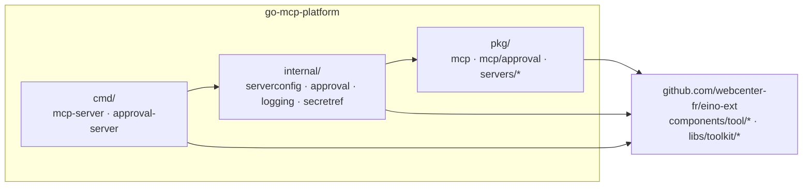
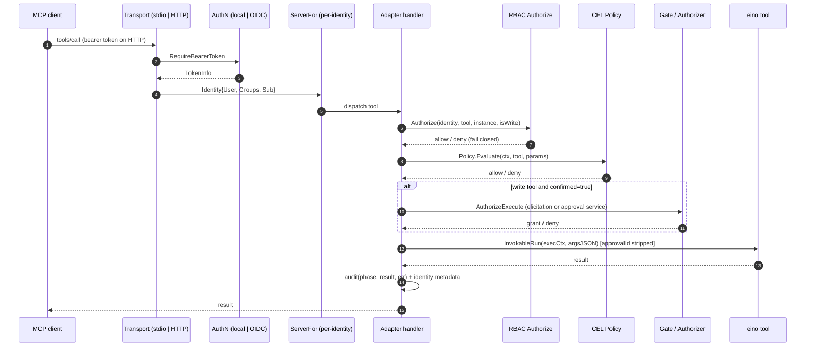

# Architecture — go-mcp-platform

> **Scope:** the repository layout, the module boundary with
> `github.com/webcenter-fr/eino-ext`, the public MCP toolkit (`pkg/mcp`), the
> embeddable family servers (`pkg/servers/*`), the binary wiring
> (`internal/serverconfig`) and the approval service (`internal/approval`).
>
> **Companion documents:**
> - [`01-mcp-hard-approval.en.md`](./01-mcp-hard-approval.en.md) — the
>   out-of-band approval service.
> - [`02-deployment-and-ci.en.md`](./02-deployment-and-ci.en.md) — images,
>   Helm chart and CI.
> - Français : [`00-architecture.fr.md`](./00-architecture.fr.md)

## 1. Purpose

`go-mcp-platform` is the deployable half of the former eino-ext monorepo. It
exposes eino tool families as MCP servers and adds the security layer an
operator needs: authentication, RBAC, human approval for write tools, audit,
container images and a Helm chart.

The reusable eino components and shared libraries stay in
[`webcenter-fr/eino-ext`](https://github.com/webcenter-fr/eino-ext). This
repository consumes them as a normal Go module dependency.

## 2. Repository layout and dependency rule

```
cmd/  ->  internal/  ->  pkg/  ->  github.com/webcenter-fr/eino-ext
```



The rule is one-directional: `pkg/` never imports `internal/` or `cmd/`, and
nothing in this repository is imported by eino-ext. The arrows may skip a layer
(`cmd/` may import `pkg/` directly), but they never point outward.

### 2.1 `pkg` vs `internal`

- `pkg/` is the **public API**. `pkg/mcp` is a generic MCP toolkit that another
  Go program can embed; `pkg/mcp/approval` is the approval-service client;
  `pkg/servers/*` are ready-made per-family servers. These packages must stay
  free of binary wiring and of the approval service's private dependencies.
- `internal/` is **private implementation**. `internal/serverconfig` reads the
  YAML configuration and wires a family into a server; `internal/approval`
  owns the approval service, its store backends and the embedded Nuxt UI;
  `internal/logging` and `internal/secretref` are small process helpers. Go
  prevents external modules from importing `internal/`, so these APIs can
  change without a semver break.

## 3. Module boundary

The platform imports exactly seven eino-ext packages:

| Package | Used for |
|---|---|
| `components/tool/kubernetes` | Kubernetes tool family (`k8stool.Configs`, `WriteToolNames`) |
| `components/tool/argocd` | ArgoCD tool family (`argocdtool.Configs`) |
| `components/tool/prometheus` | Prometheus tool family (`promtool.Configs`) |
| `components/tool/grafana` | Grafana tool family (`grafanatool.Configs`) |
| `libs/toolkit/safety` | Gate, policy, audit and authorization primitives |
| `libs/toolkit/validate` | Shared `validate.Struct` helper |
| `libs/toolkit/osclient` | OpenSearch client used by the approval store |

`libs/toolkit/confirm` is used transitively by the tool packages, never
imported directly by platform code.

The dependency is a normal `require github.com/webcenter-fr/eino-ext vX.Y.Z`.
For local development against a sibling checkout, a **gitignored** `go.work`
adds `use ../eino-ext`. A committed `replace` directive is forbidden: CI has no
sibling checkout, and a published module with a `replace` is unusable for
downstream consumers.

## 4. The MCP toolkit (`pkg/mcp`)

`pkg/mcp` turns a slice of eino `tool.InvokableTool` values into an MCP server
with authentication, RBAC and approval.

### 4.1 Adapter

`adapter.go` wraps each eino tool as an `mcpsdk.Tool`. For write tools it
publishes an optional `approvalId` property in the input schema and strips it
before `InvokableRun`, so the typed parameter structs of the tools never see
it. The adapter is also where the request path (identity → authz → policy →
gate → execute → audit) is implemented.

### 4.2 Authentication providers

The HTTP transport is wrapped with the MCP Go SDK's
`auth.RequireBearerToken` middleware. Providers implement the SDK's
`auth.TokenVerifier` and are tried in order; the first success wins. All
failures return 401 with a `WWW-Authenticate` header (including RFC 9728
`resource_metadata` when configured).

- **local** — static bearer tokens mapped to identities. Verification compares
  SHA-256 digests with `crypto/subtle.ConstantTimeCompare`; all tokens are
  always compared, so there is no timing leak of which tokens exist.
- **oidc** — verifies OIDC-issued JWT access tokens with
  `github.com/coreos/go-oidc/v3` (JWKS signature, issuer, audience, expiry).
  Claims map to `Identity`: `UserClaim` (default `preferred_username`, fallback
  `sub`) → `Identity.User`; `SubClaim` (default `sub`) → `Identity.Sub`;
  `GroupsClaim` (default `groups`) → `Identity.Groups`; the `scope` claim →
  token scopes.

`Identity.Sub` is the stable subject used for approval binding. It must match
the approval service's OIDC `sub`, otherwise the default self-approve policy
denies the requester's own approvals (fail closed).

For **stdio** (a trusted local process) there is no bearer token: the identity
is `Config.LocalIdentity`, still subject to RBAC.

### 4.3 Authorization (RBAC)

Rules map users/groups to operations, instances and tools. Within a rule the
`Users` and `Groups` conditions are AND-ed; across rules the union of matching
rules grants access. **Fail closed: no matching rule → deny.**

Enforcement happens at two points:

- **`tools/list`** — `ServerFor` builds a per-identity `*mcpsdk.Server` (cached
  by identity key) that registers only the tools whose category the identity
  may use.
- **`tools/call`** — the handler extracts the instance argument
  (`Config.InstanceParam`: `cluster` for Kubernetes, `instance` for the others)
  and checks category + instance + tool pattern. Tools without an instance
  argument (e.g. `kubernetes_cluster_list`) are checked at category level only.

### 4.4 Transports

- **stdio** — `Server.ServeStdio(ctx)`: a single session with the local
  identity.
- **HTTP (streamable)** — `Server.HTTPHandler()` /
  `Server.ListenAndServeHTTP(ctx, addr)`: stateful mode only. Stateless mode
  rejects server→client requests, which would break elicitation-based approval.

### 4.5 Why the LLM cannot self-approve

Real execution of a write tool requires a human decision. The model-supplied
`confirmed=true` argument is **never** an authorization source; it only
triggers the authorizer.

| Channel | Controlled by | Trusted as authorization? |
|---|---|---|
| Tool arguments (incl. `confirmed=true`, `dryRun`, `approvalId`) | LLM | **No** — `confirmed=true` only triggers the authorizer; `approvalId` is only a lookup key |
| Conversation text ("the user already said yes") | LLM | **No** — approval is never read from chat text |
| Bearer token | Verified server-side | Yes — but the LLM cannot forge it |
| Elicitation response (accept/decline) | **Human**, via the MCP client UI | **Yes** (elicitation path) |
| Signed approval receipt | **Human**, via the approval service | **Yes** (service path) |
| `context.Context` grant (`safety.WithExecutionAuthorized`) | Server only | Yes — the model cannot write to ctx |

Two authorizers implement `safety.ExecutionAuthorizer`:

- **`ElicitationAuthorizer`** (default) — the human decides in the MCP client
  UI via `session.Elicit(...)`.
- **`ApprovalURLAuthorizer`** — opt-in via `Config.Approval.Service`; the human
  decides out-of-band in a browser, independent of the agent process, the LLM
  and the MCP client UI.

The safety middleware's `AllowModelConfirmation` escape hatch (which trusts a
model-supplied `confirmed=true`) is deliberately **not** wired into the MCP
server.

## 5. MCP handler request path



The order is fixed: **identity → authz → policy → gate → execute → audit**.
Every tool call emits a `safety.AuditEvent` (phase read/dry-run/execute/rejected
plus identity metadata) through `Config.AuditSink` (default `safety.LogSink`).
Write calls also record `argsHash` and `argsTruncated`.

## 6. Entry-point signatures

These signatures are the platform's contract. They are stable across the split.

```go
// pkg/mcp — public toolkit
func NewServer(ctx context.Context, cfg *Config) (*Server, error)
func (s *Server) ServerFor(ctx context.Context, id *Identity) (*mcpsdk.Server, error)
func (s *Server) ServeStdio(ctx context.Context) error
func (s *Server) HTTPHandler() http.Handler
func (s *Server) ListenAndServeHTTP(ctx context.Context, addr string) error
func Authorize(cfg *AuthzConfig, id *Identity, tool, instance string, isWrite bool) error

// pkg/servers/<family> — embeddable family servers
func kubernetes.NewServer(ctx context.Context, configs k8stool.Configs, scheme *runtime.Scheme, cfg *mcpserver.Config) (*mcpserver.Server, error)
func argocd.NewServer(ctx context.Context, configs argocdtool.Configs, cfg *mcpserver.Config) (*mcpserver.Server, error)
func prometheus.NewServer(ctx context.Context, configs promtool.Configs, cfg *mcpserver.Config) (*mcpserver.Server, error)
func grafana.NewServer(ctx context.Context, configs grafanatool.Configs, cfg *mcpserver.Config) (*mcpserver.Server, error)

// internal/serverconfig — binary wiring
func Load(path string, overrides map[string]any) (*Config, error)
func Build(ctx context.Context, cfg *Config) (*mcpserver.Server, error)
func OpsHandler(ready func() error) http.Handler

// internal/approval — approval service
func New(ctx context.Context, cfg *Config) (*Server, error)
func (s *Server) Handler() http.Handler
func HashServerToken(token string) string

// internal/approval/store — domain
type ApprovalStore interface { /* unchanged */ }
func PollDecision(ctx context.Context, s ApprovalStore, id string, wait, interval time.Duration) (*Record, error)
```

## 7. Implementation deep-dives

### 7.1 Per-identity server cache

`ServerFor` keys the cache by the identity's user, groups and subject. A new
identity gets a fresh `*mcpsdk.Server` whose tool set is filtered by the RBAC
rules, so `tools/list` never advertises a tool the identity cannot call. The
cache is bounded by the number of distinct identities seen by the process.

### 7.2 Approval binding

The adapter computes the canonical `argsHash` over the tool arguments
(excluding `dryRun`, `confirmed` and `approvalId`) and binds it to the approval
request. The approval service recomputes the hash from the submitted args and
rejects a mismatch. The signed receipt carries the hash, so approving X can
never execute Y. See
[`01-mcp-hard-approval.en.md`](./01-mcp-hard-approval.en.md) for the full flow.

### 7.3 Binary wiring

`internal/serverconfig.Load` builds a viper instance with `MCP_PLATFORM_*`
environment support, applies defaults, reads the YAML file, applies CLI
overrides, unmarshals with `ErrorUnused: true`, resolves secret references,
validates the selected family and calls `validate.Struct`. `Build` translates
the family entries into the eino-ext tool configs and calls the matching
`pkg/servers/*.NewServer`. Client construction stays lazy: no external service
is contacted at build time.
