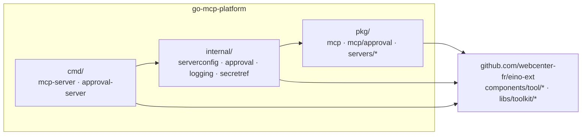
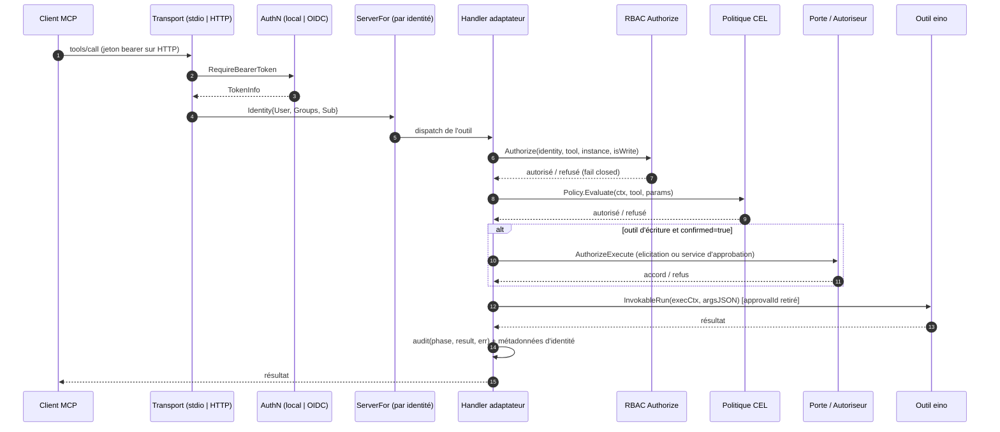

# Architecture — go-mcp-platform

> **Périmètre :** la disposition du dépôt, la frontière de module avec
> `github.com/webcenter-fr/eino-ext`, la boîte à outils MCP publique
> (`pkg/mcp`), les serveurs de famille embarquables (`pkg/servers/*`), le
> câblage des binaires (`internal/serverconfig`) et le service d'approbation
> (`internal/approval`).
>
> **Documents associés :**
> - [`01-mcp-hard-approval.fr.md`](./01-mcp-hard-approval.fr.md) — le service
>   d'approbation hors bande.
> - [`02-deployment-and-ci.fr.md`](./02-deployment-and-ci.fr.md) — images,
>   chart Helm et CI.
> - English : [`00-architecture.en.md`](./00-architecture.en.md)

## 1. Objectif

`go-mcp-platform` est la moitié déployable de l'ancien monorepo eino-ext. Il
expose les familles d'outils eino comme serveurs MCP et ajoute la couche de
sécurité nécessaire à un opérateur : authentification, RBAC, approbation
humaine des outils d'écriture, audit, images de conteneur et chart Helm.

Les composants eino réutilisables et les bibliothèques partagées restent dans
[`webcenter-fr/eino-ext`](https://github.com/webcenter-fr/eino-ext). Ce dépôt
les consomme comme une dépendance de module Go normale.

## 2. Disposition du dépôt et règle de dépendance

```
cmd/  ->  internal/  ->  pkg/  ->  github.com/webcenter-fr/eino-ext
```



La règle est unidirectionnelle : `pkg/` n'importe jamais `internal/` ni `cmd/`,
et rien dans ce dépôt n'est importé par eino-ext. Les flèches peuvent sauter une
couche (`cmd/` peut importer `pkg/` directement), mais elles ne pointent jamais
vers l'extérieur.

### 2.1 `pkg` vs `internal`

- `pkg/` est l'**API publique**. `pkg/mcp` est une boîte à outils MCP générique
  qu'un autre programme Go peut embarquer ; `pkg/mcp/approval` est le client du
  service d'approbation ; `pkg/servers/*` sont des serveurs de famille prêts à
  l'emploi. Ces paquets doivent rester exempts de câblage de binaire et des
  dépendances privées du service d'approbation.
- `internal/` est l'**implémentation privée**. `internal/serverconfig` lit la
  configuration YAML et câble une famille dans un serveur ; `internal/approval`
  possède le service d'approbation, ses backends de store et l'UI Nuxt
  embarquée ; `internal/logging` et `internal/secretref` sont de petits helpers
  de processus. Go empêche les modules externes d'importer `internal/`, donc ces
  API peuvent évoluer sans rupture semver.

## 3. Frontière de module

La plateforme importe les paquets eino-ext suivants :

| Paquet | Utilisé pour |
|---|---|
| `components/tool/kubernetes` | Famille d'outils Kubernetes (`k8stool.Configs`, `WriteToolNames`) |
| `components/tool/argocd` | Famille d'outils ArgoCD (`argocdtool.Configs`) |
| `components/tool/prometheus` | Famille d'outils Prometheus (`promtool.Configs`) |
| `components/tool/grafana` | Famille d'outils Grafana (`grafanatool.Configs`) |
| `components/tool/github` | Famille d'outils GitHub (`githubtool.Configs`, `NewAllTools`, `WriteToolNames`) |
| `libs/toolkit/safety` | Primitives de porte, politique, audit et autorisation |
| `libs/toolkit/validate` | Helper partagé `validate.Struct` |
| `libs/toolkit/osclient` | Client OpenSearch utilisé par le store d'approbation |
| `libs/toolkit/dagger` | Client Dagger paresseux, options de conteneur, export du workspace |
| `libs/toolkit/egress` | Politique d'egress et proxy HTTP CONNECT |
| `libs/toolkit/profile` | Détection des marqueurs de projet et sélection de l'image de base |
| `libs/toolkit/workspace` | Disposition session/workspace et résolution de chemins sans symlink |
| `libs/toolkit/fileutil` | Validation des répertoires racines et des segments de chemin |

`libs/toolkit/confirm` est utilisé transitivement par les paquets d'outils,
jamais importé directement par le code de la plateforme.

La dépendance est un `require github.com/webcenter-fr/eino-ext vX.Y.Z` normal.
Pour le développement local contre un checkout voisin, un `go.work`
**gitignoré** ajoute `use ../eino-ext`. Une directive `replace` commitée est
interdite : la CI n'a pas de checkout voisin, et un module publié avec un
`replace` est inutilisable pour les consommateurs en aval.

## 4. La boîte à outils MCP (`pkg/mcp`)

`pkg/mcp` transforme une liste de `tool.InvokableTool` eino en serveur MCP avec
authentification, RBAC et approbation.

### 4.1 Adaptateur

`adapter.go` enveloppe chaque outil eino comme un `mcpsdk.Tool`. Pour les outils
d'écriture, il publie une propriété optionnelle `approvalId` dans le schéma
d'entrée et la retire avant `InvokableRun`, afin que les structs de paramètres
typés des outils ne la voient jamais. L'adaptateur implémente aussi le chemin de
requête (identité → authz → politique → porte → exécution → audit).

### 4.2 Fournisseurs d'authentification

Le transport HTTP est enveloppé par le middleware `auth.RequireBearerToken` du
SDK MCP Go. Les fournisseurs implémentent l'interface `auth.TokenVerifier` du
SDK et sont essayés dans l'ordre ; le premier succès gagne. Tous les échecs
renvoient 401 avec un en-tête `WWW-Authenticate` (y compris `resource_metadata`
RFC 9728 lorsqu'il est configuré).

- **local** — jetons bearer statiques mappés à des identités. La vérification
  compare des digests SHA-256 avec `crypto/subtle.ConstantTimeCompare` ; tous
  les jetons sont toujours comparés, donc pas de fuite temporelle sur l'existence
  des jetons.
- **oidc** — vérifie les jetons d'accès JWT émis par OIDC avec
  `github.com/coreos/go-oidc/v3` (signature JWKS, issuer, audience, expiration).
  Les claims sont mappés vers `Identity` : `UserClaim` (défaut
  `preferred_username`, repli `sub`) → `Identity.User` ; `SubClaim` (défaut
  `sub`) → `Identity.Sub` ; `GroupsClaim` (défaut `groups`) →
  `Identity.Groups` ; le claim `scope` → les scopes du jeton.

`Identity.Sub` est le sujet stable utilisé pour le binding d'approbation. Il
doit correspondre au `sub` OIDC du service d'approbation, sinon la politique
d'auto-approbation par défaut refuse les approbations du demandeur lui-même
(fail closed).

Pour **stdio** (un processus local de confiance), il n'y a pas de jeton bearer :
l'identité est `Config.LocalIdentity`, toujours soumise au RBAC.

### 4.3 Autorisation (RBAC)

Les règles mappent utilisateurs/groupes vers des opérations, instances et
outils. Dans une règle, les conditions `Users` et `Groups` sont combinées en
ET ; entre règles, l'union des règles correspondantes accorde l'accès.
**Fail closed : aucune règle correspondante → refus.**

L'application a lieu à deux endroits :

- **`tools/list`** — `ServerFor` construit un `*mcpsdk.Server` par identité
  (mis en cache par clé d'identité) qui n'enregistre que les outils dont la
  catégorie est autorisée pour l'identité.
- **`tools/call`** — le handler extrait l'argument d'instance
  (`Config.InstanceParam` : `cluster` pour Kubernetes, `instance` pour les
  autres) et vérifie catégorie + instance + motif d'outil. Les outils sans
  argument d'instance (par ex. `kubernetes_cluster_list`) ne sont vérifiés
  qu'au niveau de la catégorie.

### 4.4 Transports

- **stdio** — `Server.ServeStdio(ctx)` : une session unique avec l'identité
  locale.
- **HTTP (streamable)** — `Server.HTTPHandler()` /
  `Server.ListenAndServeHTTP(ctx, addr)` : mode stateful uniquement. Le mode
  stateless rejette les requêtes serveur→client, ce qui casserait l'approbation
  par elicitation.

### 4.5 Ensembles d'outils par identité (`ToolsFor`)

`Config.ToolsFor` et `Config.WriteToolsFor` permettent à une famille de
construire son ensemble d'outils à partir de l'identité authentifiée au moment
de la construction. Ils priment sur `Tools`/`WriteTools` et sont appelés une
fois par identité distincte ; le résultat est mis en cache avec le serveur par
identité. Définir `ToolsFor` force un cache de serveurs indexé par identité même
sans politique RBAC, donc deux identités ne partagent jamais un ensemble
d'outils (ni un workspace). La famille developer utilise ce hook pour lier
chaque identité à `<WorkspaceRoot>/<sha256(subject)[:16]>`.

### 4.6 Prompts et ressources

`Config.Prompts`/`Resources` (et leurs équivalents par identité `PromptsFor`/
`ResourcesFor`) exposent des prompts et ressources MCP. Ce sont des opérations
de **lecture** : le RBAC réutilise `Authorizer.Authorize(id, name, "", false)`,
en faisant correspondre le nom du prompt/de la ressource à `AccessRule.Tools`
(par exemple `developer_*`). Le filtre est appliqué à l'enregistrement
(`prompts/list`, `resources/list`) puis dans le handler (`prompts/get`,
`resources/read`), comme le double contrôle tools/list + tools/call. Chaque
lecture émet un `safety.AuditEvent` avec `PhaseRead` et `ToolName`
`prompt:<name>` ou `resource:<uri>`.

### 4.7 Pourquoi le LLM ne peut pas s'auto-approuver

L'exécution réelle d'un outil d'écriture requiert une décision humaine.
L'argument `confirmed=true` fourni par le modèle n'est **jamais** une source
d'autorisation ; il ne fait que déclencher l'autoriseur.

| Canal | Contrôlé par | Fiable comme autorisation ? |
|---|---|---|
| Arguments d'outil (dont `confirmed=true`, `dryRun`, `approvalId`) | LLM | **Non** — `confirmed=true` ne fait que déclencher l'autoriseur ; `approvalId` n'est qu'une clé de recherche |
| Texte de conversation (« l'utilisateur a déjà dit oui ») | LLM | **Non** — l'approbation n'est jamais lue depuis le texte du chat |
| Jeton bearer | Vérifié côté serveur | Oui — mais le LLM ne peut pas le forger |
| Réponse d'elicitation (accept/decline) | **Humain**, via l'UI du client MCP | **Oui** (chemin elicitation) |
| Reçu d'approbation signé | **Humain**, via le service d'approbation | **Oui** (chemin service) |
| Grant `context.Context` (`safety.WithExecutionAuthorized`) | Serveur uniquement | Oui — le modèle ne peut pas écrire dans le ctx |

Deux autoriseurs implémentent `safety.ExecutionAuthorizer` :

- **`ElicitationAuthorizer`** (défaut) — l'humain décide dans l'UI du client
  MCP via `session.Elicit(...)`.
- **`ApprovalURLAuthorizer`** — opt-in via `Config.Approval.Service` ; l'humain
  décide hors bande dans un navigateur, indépendamment du processus de l'agent,
  du LLM et de l'UI du client MCP.

L'échappatoire `AllowModelConfirmation` du middleware de sûreté (qui fait
confiance à un `confirmed=true` fourni par le modèle) n'est délibérément **pas**
câblée dans le serveur MCP.

## 5. Chemin de requête du handler MCP



L'ordre est fixe : **identité → authz → politique → porte → exécution → audit**.
Chaque appel d'outil émet un `safety.AuditEvent` (phase read/dry-run/execute/
rejected plus métadonnées d'identité) via `Config.AuditSink` (défaut
`safety.LogSink`). Les appels d'écriture enregistrent aussi `argsHash` et
`argsTruncated`.

## 6. Signatures des points d'entrée

Ces signatures constituent le contrat de la plateforme. Elles sont stables
depuis la séparation.

```go
// pkg/mcp — boîte à outils publique
func NewServer(ctx context.Context, cfg *Config) (*Server, error)
func (s *Server) ServerFor(ctx context.Context, id *Identity) (*mcpsdk.Server, error)
func (s *Server) ServeStdio(ctx context.Context) error
func (s *Server) HTTPHandler() http.Handler
func (s *Server) ListenAndServeHTTP(ctx context.Context, addr string) error
func Authorize(cfg *AuthzConfig, id *Identity, tool, instance string, isWrite bool) error

// pkg/servers/<family> — serveurs de famille embarquables
func kubernetes.NewServer(ctx context.Context, configs k8stool.Configs, scheme *runtime.Scheme, cfg *mcpserver.Config) (*mcpserver.Server, error)
func argocd.NewServer(ctx context.Context, configs argocdtool.Configs, cfg *mcpserver.Config) (*mcpserver.Server, error)
func prometheus.NewServer(ctx context.Context, configs promtool.Configs, cfg *mcpserver.Config) (*mcpserver.Server, error)
func grafana.NewServer(ctx context.Context, configs grafanatool.Configs, cfg *mcpserver.Config) (*mcpserver.Server, error)
func developer.NewServer(ctx context.Context, cfg *developer.Config, mcpCfg *mcpserver.Config) (*mcpserver.Server, error)
func developer.NewServerWithRunner(ctx context.Context, cfg *developer.Config, mcpCfg *mcpserver.Config) (*mcpserver.Server, io.Closer, error)
func developer.WriteToolNames(cfg *developer.Config) []string

// internal/serverconfig — câblage des binaires
func Load(path string, overrides map[string]any) (*Config, error)
func Build(ctx context.Context, cfg *Config) (*mcpserver.Server, error)
func OpsHandler(ready func() error) http.Handler

// internal/approval — service d'approbation
func New(ctx context.Context, cfg *Config) (*Server, error)
func (s *Server) Handler() http.Handler
func HashServerToken(token string) string

// internal/approval/store — domaine
type ApprovalStore interface { /* inchangé */ }
func PollDecision(ctx context.Context, s ApprovalStore, id string, wait, interval time.Duration) (*Record, error)
```

## 7. Plongées dans l'implémentation

### 7.1 Cache de serveurs par identité

`ServerFor` indexe le cache par utilisateur, groupes et sujet de l'identité.
Une nouvelle identité obtient un `*mcpsdk.Server` frais dont l'ensemble d'outils
est filtré par les règles RBAC, donc `tools/list` n'annonce jamais un outil que
l'identité ne peut pas appeler. Le cache est borné par le nombre d'identités
distinctes vues par le processus.

### 7.2 Binding d'approbation

L'adaptateur calcule le `argsHash` canonique sur les arguments de l'outil (hors
`dryRun`, `confirmed` et `approvalId`) et le lie à la demande d'approbation. Le
service d'approbation recalcule le hash à partir des arguments soumis et rejette
une divergence. Le reçu signé porte le hash, donc approuver X ne peut jamais
exécuter Y. Voir [`01-mcp-hard-approval.fr.md`](./01-mcp-hard-approval.fr.md)
pour le flux complet.

### 7.3 Les valeurs de session adk sont inaccessibles depuis MCP

`workspace.Layout` et `github.Config.CloneDir` résolvent les chemins par
session via `fileutil.SessionFromContext` → `adk.GetSessionValue(ctx, key)`. Un
handler d'outil MCP ne peut jamais peupler une session adk :
`adk.AddSessionValue` est un no-op silencieux sans contexte de run adk, et les
seuls constructeurs sont non exportés. Avec `RequireSession: true`, chaque appel
échoue ; avec `RequireSession: false`, chaque identité résout le namespace
littéral `default`, donc le shell de l'utilisateur A pourrait lire le code
privé cloné de l'utilisateur B.

La famille developer dérive donc la racine du workspace de l'**identité
authentifiée** (côté serveur, non falsifiable) et construit les outils de cette
identité via `ToolsFor`. Les outils GitHub sont construits avec `CloneDir` égal
à la racine de l'identité et `RequireSession: false` ; le segment de session
`default` à l'intérieur de cette racine est sans danger puisque la racine
elle-même est propre à l'identité.

### 7.4 Câblage des binaires

`internal/serverconfig.Load` construit une instance viper avec le support
d'environnement `MCP_PLATFORM_*`, applique les valeurs par défaut, lit le
fichier YAML, applique les surcharges CLI, démarshalle avec `ErrorUnused: true`,
résout les références de secrets, valide la famille sélectionnée puis appelle
`validate.Struct`. `Build` traduit les entrées de famille en configurations
d'outils eino-ext et appelle le `pkg/servers/*.NewServer` correspondant. La
construction des clients reste paresseuse : aucun service externe n'est contacté
au build.
