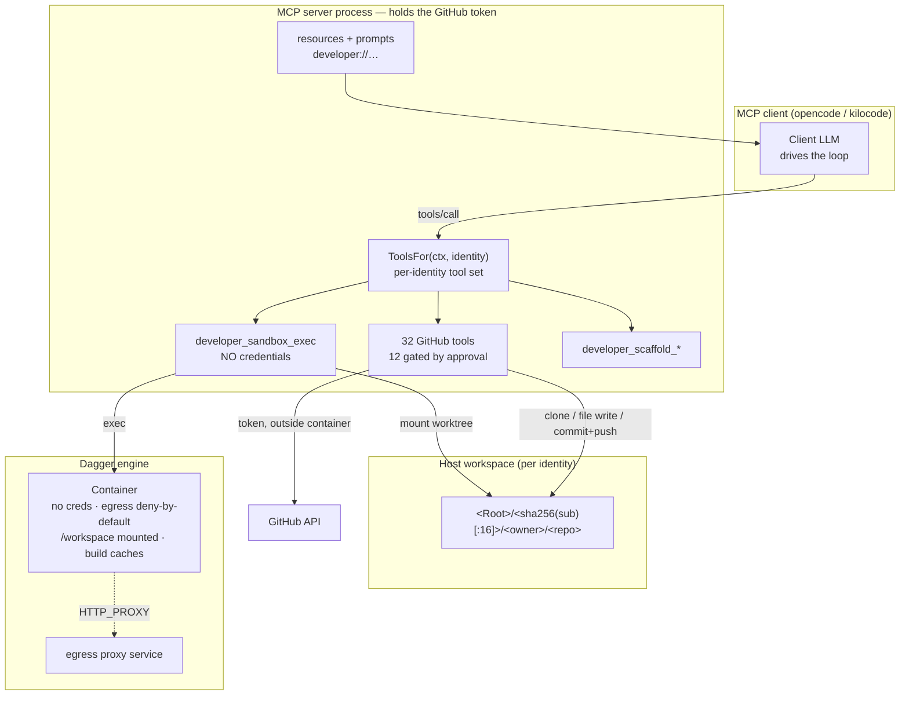
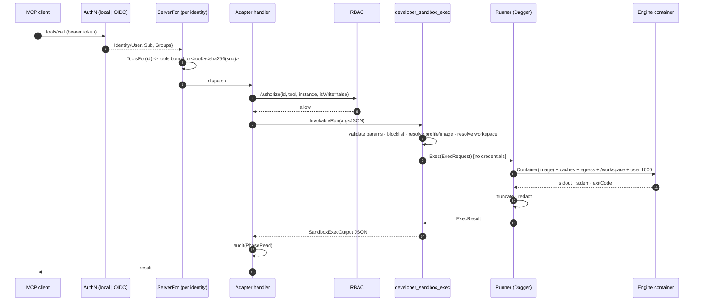
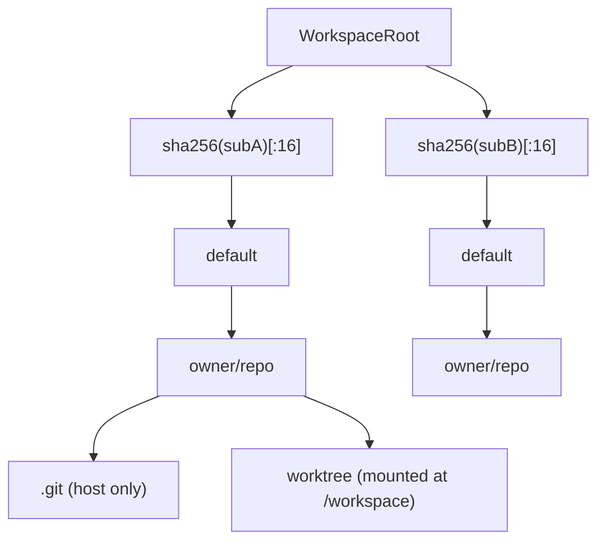
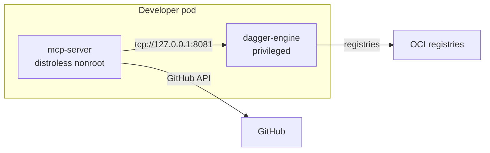

# Developer sandbox — credential-free developer MCP family

> **Scope:** the `pkg/servers/developer` family: the credential-free Dagger
> sandbox, the GitHub tool family, the scaffolding surface, the per-identity
> workspace model, the egress reality and the three engine modes.
>
> **Companion documents:**
> - [`00-architecture.en.md`](./00-architecture.en.md) — the MCP toolkit and
>   the `ToolsFor`/prompts/resources additions.
> - [`02-deployment-and-ci.en.md`](./02-deployment-and-ci.en.md) — the
>   developer image, the StatefulSet and the chart guards.
> - Français : [`03-developer-sandbox.fr.md`](./03-developer-sandbox.fr.md)

## 1. Purpose

The developer family gives an MCP client the toolchain a developer needs —
compiler, linter, vulnerability check, test, git, GitHub — plus language
best-practice prompts, project/`AGENTS.md`/opencode bootstrap, and a defined
agent lifecycle (architect → develop → review → security → deep analysis) with
a model **tier** per step.

The decisive constraint is not "narrow the command allowlist". LLMs are well
trained on the shell ecosystem (`go build`, `npm test`, `pytest`). The security
boundary is **isolation plus credential absence**:

1. **Full shell, not a narrowed allowlist.** Capability is preserved.
2. **The sandbox holds no credentials.** No `GITHUB_TOKEN`, no kubeconfig, no
   `~/.git-credentials`, no SSH keys, no cloud credentials.
3. **Network egress is deny-by-default** and never overridable by an
   LLM-supplied tool parameter.
4. **Credentialed operations go through gated tools.** GitHub writes run in the
   MCP process under RBAC + dry-run/confirmed + signed-receipt approval.
5. **Per-user workspace isolation.** Two identities never see each other's
   cloned private source.
6. **Bootstrap the agentic developer experience** over MCP tools, prompts and
   resources.

## 2. Trust boundary



Inside the container: full shell, no credentials, egress deny-by-default — the
blast radius is the container. Outside: everything credentialed is an MCP tool
under RBAC + approval. `ExportWorkspace` never writes `.git` back on the export
path, but the workspace is mounted read-write into the container, so a
compromised container can still modify `.git` directly through the mount; the
export exclusion only prevents the export step from clobbering refs.

## 3. One `developer_sandbox_exec`



A non-zero exit code is **not** a tool error: the LLM reads the compiler/test
output and self-corrects. Only infrastructure failures (engine unreachable,
timeout, pull failure) return a Go error.

## 4. Workspace layout



The subject comes from the verified bearer token (`Identity.Subject()`), so the
model cannot forge it. A nil identity (stdio with no `LocalIdentity`) maps to
the `local` segment. `owner`/`repo` are sanitized with
`fileutil.SanitizePathSegment`; `workdir` goes through `workspace.ResolvePath`,
which rejects traversal **and** symlinks.

## 5. Egress reality

The pinned eino-ext release stores `WithEgressPolicy` but does not apply it
(`Container()` never reads the policy), and `EgressProxyService` is a
placeholder. The developer family therefore reports `egressEnforced=false` from
`developer_sandbox_info` and logs a prominent startup WARN. This is a **soft**
control even once the upstream proxy is wired:

| Client | Honors `HTTP_PROXY`/`HTTPS_PROXY`? |
|---|---|
| `go`, `npm`, `pip`, `cargo`, `mvn`, `composer`, `curl`, `wget` | Yes |
| `psql`, `redis-cli`, `nc`, `kubectl`, any direct dialer | **No** |

**Operator runbook for a hard guarantee:**

1. Run a dedicated Dagger engine (sidecar or `dagger-kubernetes`), not a shared
   engine used by other tenants.
2. Apply the chart's dedicated developer NetworkPolicy: deny `10.0.0.0/8`,
   `172.16.0.0/12`, `192.168.0.0/16` and `169.254.169.254/32` on egress; allow
   DNS and the public internet.
3. On the node/engine, add nftables/iptables egress rules for the same ranges.
4. Never enable `egress.allowLocalNetwork` unless the acknowledgement flag is
   set and the risk is understood.

## 6. Engine modes

| Mode | Topology | Requirements |
|---|---|---|
| `sidecar` | A privileged Dagger engine container in the same pod. | `engine.sidecar.persistence.enabled` (or an explicit cold-cache acknowledgement). |
| `cloud` | Dagger Cloud. | `cloudTokenFile`/`cloudTokenEnv` (or an existing Secret). |
| `dagger-kubernetes` | A self-hosted Dagger-Cloud-compatible supervisor. | `cloudURL` + token; `runnerHost` defaults to `dagger-cloud://self`. |



The developer image must carry the Dagger CLI. The SDK's runner-host path
(`_EXPERIMENTAL_DAGGER_RUNNER_HOST`) is consumed only inside
`startCLISession`, which `exec`s the CLI binary; there is no Go-native
runner-host connection. The distroless MCP image has no CLI, so
`Dockerfile.developer` adds a pinned, checksum-verified static CLI and a
writable `XDG_CACHE_HOME`.

## 7. Lifecycle and model tiers

| Stage | Purpose | Tier |
|---|---|---|
| `architect` | Understand the request, map the code, propose a plan | `strong-reasoning` |
| `develop` | Implement the approved plan with tests | `fast-coding` |
| `review` | Review correctness, compatibility, security, simplicity | `strong-reasoning` |
| `security` | Threat-model the change and verify controls | `strong-reasoning` |
| `deep-security` | Wide read-only security analysis | `long-context` |
| `deep-bug-search` | Wide read-only bug hunt | `long-context` |

Templates name a **tier**, never a concrete model id. Model names change far
faster than the workflow, and the operator owns the tier → model mapping.

## 8. Evaluated and deferred: in-engine Dagger LLM

An in-engine `dag.LLM()` agent was evaluated and deferred:

- A Dagger-LLM tool call starts a fresh conversation every invocation, must
  re-establish repo understanding each time, and double-bills (client
  orchestration tokens + engine inner-loop tokens).
- Dagger LLM exposes the Dagger object API as tools, so the model must express
  `go test` as `container.withExec([…]).stdout()` — a far less-trained idiom
  than bash, contradicting the premise that LLMs are strong at the shell.
- It collapses approval granularity to one call per agent run: the human would
  approve "run an agent", not "push to main". That destroys per-tool-call RBAC
  and signed receipts.

The extension point is defined now:

```go
type DeepAnalyzer interface {
    Analyze(ctx context.Context, workspacePath string, mode LifecycleStage) (string, error)
}
```

`Config.DeepAnalyzer` is optional; when nil, no analysis tool is registered.

## 9. Residual risk

If the MCP client runs on a developer laptop, that client already has the
laptop's `~/.kube/config`, `~/.git-credentials` and SSH keys. This server cannot
prevent that. The guarantee is narrower: **the sandbox we provide holds no
credentials and its egress is restricted; credentials the client process
already possesses are outside this threat model.**

## 10. Threat model

| Threat | Control | Residual risk |
|---|---|---|
| LLM exfiltrates a GitHub token via shell | No token in the container; the token lives only in the MCP process. | A compromised MCP process still holds it. |
| LLM reaches the Kubernetes API from the sandbox | No kubeconfig/SA token in the container; egress denies RFC1918 + link-local; NetworkPolicy denies private ranges. | **Soft:** raw TCP ignores `HTTP_PROXY`. |
| LLM opens TCP to a local-network service | Same as above. | Same soft-control caveat. |
| LLM widens its own egress | `allowLocalNetwork` exists only in operator config; `SandboxExecParams` has no such field. | None at the tool surface. |
| LLM picks a malicious base image | `profile` is not a tool parameter; images come from overrides/detection and are checked against `AllowedImages`. | None at the tool surface. |
| Command injection | `WithExec(argv)` — no shell. `Command` is `[]string` with `dive,required`. | A command the container runs through its own shell (e.g. `make`) is the user's build script. |
| Destructive commands | `safety.DefaultCommandBlocklist` (extended, never replaced), checked on every exec. | The container is disposable; `.git` is excluded from the export path (but the read-write mount means a compromised container can still touch `.git` directly). |
| Path traversal to the host | Per-identity root; sanitized owner/repo; `workspace.ResolvePath` rejects traversal and symlinks. | None known. |
| Cross-tenant workspace read | Per-identity root keyed by `sha256(subject)`; `ToolsFor` forces identity-keyed caching. | stdio with no `LocalIdentity` collapses to `local` — correct for a single-user process. |
| Container escape | Non-root `ContainerUser` (default `1000:1000`); no root capabilities. | The engine sidecar is privileged by necessity; isolate it. |
| Resource exhaustion | `MaxConcurrentExecs`, timeouts, output cap, workspace GC, engine limits. | A build can still fill the workspace PVC. |
| Secret leak through output | Literal + pattern redaction over stdout/stderr. | Best-effort pattern matching. |

## 11. Implementation deep-dives

### 11.1 `Runner` seam

`Runner` is the only abstraction between the tools and Dagger. `ExecRequest`
is fully resolved server-side: image, profile, workspace, workdir, user, cache
mounts, egress policy, timeout and output cap. `FakeRunner` records requests
and returns canned results, so the whole tool surface is unit-testable without
an engine. `NewDaggerRunner` connects lazily on the first `Exec`; a failed
connection is retried on the next call, not cached forever.

### 11.2 Environment scrubbing

The runner never forwards the MCP process environment. It starts from the base
image's own environment, removes credential-shaped names (`GITHUB_TOKEN`,
`KUBECONFIG`, proxy variables, loader variables, Dagger tokens), then applies
the validated per-call `Env`. `validateEnv` rejects reserved names, reserved
prefixes, credential-shaped names, NUL bytes and values over 4096 bytes.

### 11.3 Output handling

Output is filtered per line (RE2), truncated (stdout tail + stderr head, with an
explicit omission marker), sanitized to valid UTF-8, then redacted. Redaction
replaces configured literal tokens first, then credential-shaped patterns
(GitHub PATs, AWS keys, private-key headers, JWTs).

### 11.4 Scaffolding

Templates live in `prompts/` and `templates/` and are embedded with
`//go:embed`. `developer_scaffold_apply` resolves each target with
`workspace.ResolvePath(repoDir, targetPath, true)` and writes with `0o644`;
existing files are skipped unless `overwrite=true`. The same content is exposed
as MCP resources (`developer://templates`, `developer://agents/<language>`,
`developer://lifecycle/workflow`, `developer://opencode/config`) and as MCP
prompts (`developer_bootstrap`, `developer_review`,
`developer_security_audit`, `developer_lifecycle`).
