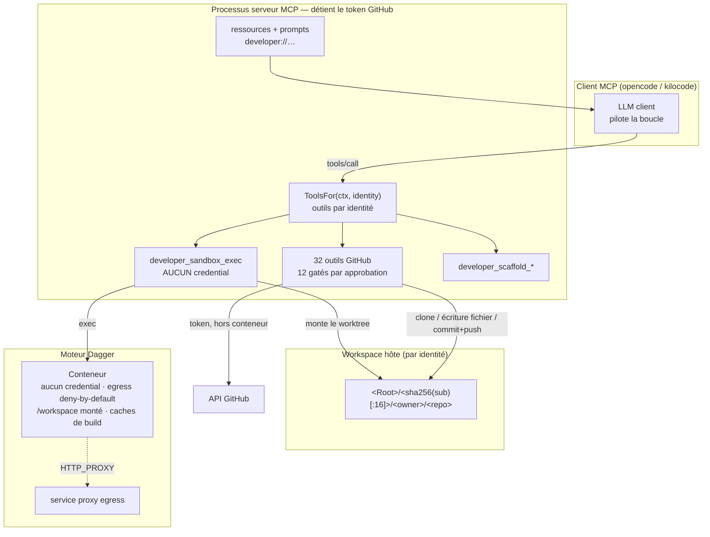
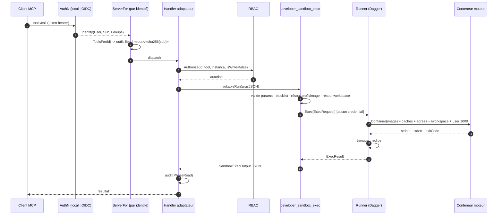
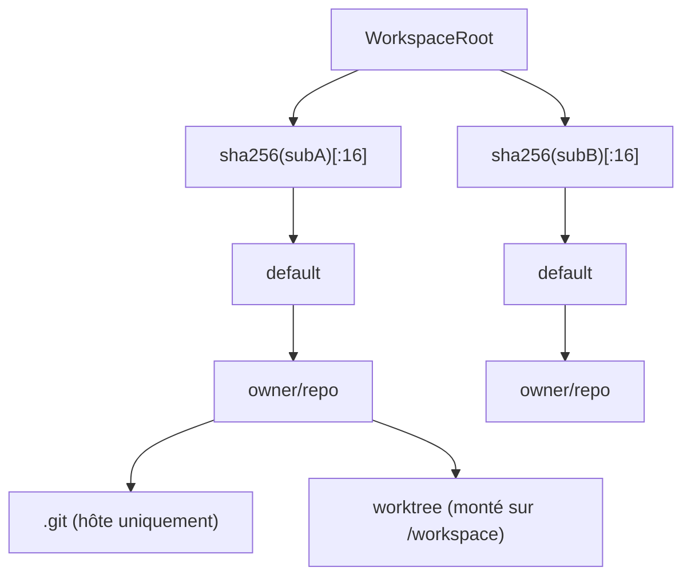
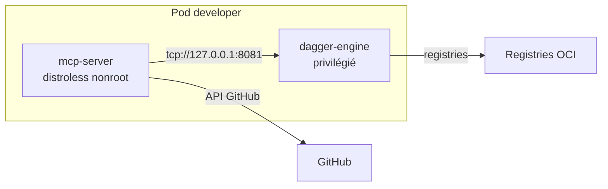

# Bac à sable développeur — famille MCP développeur sans credentials

> **Périmètre :** la famille `pkg/servers/developer` : le bac à sable Dagger
> sans credentials, la famille d'outils GitHub, la surface de scaffolding, le
> modèle de workspace par identité, la réalité de l'egress et les trois modes
> de moteur.
>
> **Documents compagnons :**
> - [`00-architecture.fr.md`](./00-architecture.fr.md) — la boîte à outils MCP
>   et les ajouts `ToolsFor`/prompts/ressources.
> - [`02-deployment-and-ci.fr.md`](./02-deployment-and-ci.fr.md) — l'image
>   developer, le StatefulSet et les garde-fous du chart.
> - English: [`03-developer-sandbox.en.md`](./03-developer-sandbox.en.md)

## 1. Objectif

La famille developer donne à un client MCP la chaîne d'outils dont un
développeur a besoin — compilateur, linter, contrôle de vulnérabilités, test,
git, GitHub — plus des prompts de bonnes pratiques par langage, un bootstrap
projet/`AGENTS.md`/opencode, et un cycle de vie d'agent défini (architecte →
développement → revue → sécurité → analyse profonde) avec un **palier** de
modèle par étape.

La contrainte décisive n'est pas « restreindre la liste des commandes ». Les
LLM sont bien entraînés sur l'écosystème shell (`go build`, `npm test`,
`pytest`). La frontière de sécurité est **l'isolation plus l'absence de
credentials** :

1. **Shell complet, pas une liste blanche restreinte.** La capacité est
   préservée.
2. **Le bac à sable ne contient aucun credential.** Pas de `GITHUB_TOKEN`, pas
   de kubeconfig, pas de `~/.git-credentials`, pas de clés SSH, pas de
   credentials cloud.
3. **L'egress réseau est deny-by-default** et jamais surchargeable par un
   paramètre d'outil fourni par le LLM.
4. **Les opérations credentialisées passent par des outils gatés.** Les écritures
   GitHub s'exécutent dans le processus MCP sous RBAC + dry-run/confirmed +
   approbation par reçu signé.
5. **Isolation du workspace par utilisateur.** Deux identités ne voient jamais
   le code privé cloné de l'autre.
6. **Amorcer l'expérience développeur agentique** via les outils, prompts et
   ressources MCP.

## 2. Frontière de confiance



Dans le conteneur : shell complet, aucun credential, egress deny-by-default — le
rayon d'action est le conteneur. Dehors : tout ce qui est credentialisé est un
outil MCP sous RBAC + approbation. `ExportWorkspace` n'écrit jamais `.git` en
retour, donc le `git` du conteneur ne peut pas corrompre les refs que
`github_commit_push` pousse.

## 3. Un `developer_sandbox_exec`



Un code de sortie non nul n'est **pas** une erreur d'outil : le LLM lit la
sortie du compilateur/test et se corrige. Seules les défaillances
d'infrastructure (moteur injoignable, timeout, échec de pull) renvoient une
erreur Go.

## 4. Disposition du workspace



Le sujet vient du token bearer vérifié (`Identity.Subject()`), donc le modèle ne
peut pas le falsifier. Une identité nulle (stdio sans `LocalIdentity`) est
mappée sur le segment `local`. `owner`/`repo` sont assainis avec
`fileutil.SanitizePathSegment` ; `workdir` passe par `workspace.ResolvePath`,
qui rejette la traversée **et** les symlinks.

## 5. Réalité de l'egress

La version épinglée d'eino-ext stocke `WithEgressPolicy` mais ne l'applique pas
(`Container()` ne lit jamais la politique), et `EgressProxyService` est un
placeholder. La famille developer rapporte donc `egressEnforced=false` via
`developer_sandbox_info` et journalise un WARN visible au démarrage. C'est un
contrôle **soft**, même une fois le proxy amont câblé :

| Client | Respecte `HTTP_PROXY`/`HTTPS_PROXY` ? |
|---|---|
| `go`, `npm`, `pip`, `cargo`, `mvn`, `composer`, `curl`, `wget` | Oui |
| `psql`, `redis-cli`, `nc`, `kubectl`, tout dialer direct | **Non** |

**Runbook opérateur pour une garantie forte :**

1. Exécuter un moteur Dagger dédié (sidecar ou `dagger-kubernetes`), pas un
   moteur partagé avec d'autres tenants.
2. Appliquer la NetworkPolicy developer dédiée du chart : refuser
   `10.0.0.0/8`, `172.16.0.0/12`, `192.168.0.0/16` et `169.254.169.254/32` en
   egress ; autoriser le DNS et l'internet public.
3. Sur le nœud/moteur, ajouter des règles nftables/iptables pour les mêmes
   plages.
4. Ne jamais activer `egress.allowLocalNetwork` sans le drapeau
   d'acquittement et sans comprendre le risque.

## 6. Modes de moteur

| Mode | Topologie | Prérequis |
|---|---|---|
| `sidecar` | Un conteneur moteur Dagger privilégié dans le même pod. | `engine.sidecar.persistence.enabled` (ou un acquittement explicite du cache froid). |
| `cloud` | Dagger Cloud. | `cloudTokenFile`/`cloudTokenEnv` (ou un Secret existant). |
| `dagger-kubernetes` | Un superviseur auto-hébergé compatible Dagger Cloud. | `cloudURL` + token ; `runnerHost` vaut `dagger-cloud://self` par défaut. |



L'image developer doit embarquer le CLI Dagger. Le chemin runner-host du SDK
(`_EXPERIMENTAL_DAGGER_RUNNER_HOST`) n'est consommé que dans
`startCLISession`, qui `exec` le binaire CLI ; il n'existe pas de connexion
runner-host native en Go. L'image MCP distroless n'a pas de CLI, donc
`Dockerfile.developer` ajoute un CLI statique épinglé et vérifié par checksum,
plus un `XDG_CACHE_HOME` inscriptible.

## 7. Cycle de vie et paliers de modèle

| Étape | Rôle | Palier |
|---|---|---|
| `architect` | Comprendre la demande, cartographier le code, proposer un plan | `strong-reasoning` |
| `develop` | Implémenter le plan approuvé avec tests | `fast-coding` |
| `review` | Revoir correction, compatibilité, sécurité, simplicité | `strong-reasoning` |
| `security` | Modéliser la menace et vérifier les contrôles | `strong-reasoning` |
| `deep-security` | Analyse de sécurité large en lecture seule | `long-context` |
| `deep-bug-search` | Chasse aux bugs large en lecture seule | `long-context` |

Les templates nomment un **palier**, jamais un identifiant de modèle concret.
Les noms de modèles changent bien plus vite que le workflow, et l'opérateur
possède le mapping palier → modèle.

## 8. Évalué et différé : LLM Dagger in-engine

Un agent `dag.LLM()` in-engine a été évalué puis différé :

- Un appel d'outil Dagger-LLM démarre une conversation neuve à chaque
  invocation, doit ré-établir la compréhension du dépôt à chaque fois, et
  double-facture (tokens d'orchestration client + tokens de boucle interne).
- Dagger LLM expose l'API objet Dagger comme outils, donc le modèle doit
  exprimer `go test` sous la forme `container.withExec([…]).stdout()` — un
  idiome bien moins entraîné que bash, ce qui contredit la prémisse selon
  laquelle les LLM sont forts sur le shell.
- Il réduit la granularité d'approbation à un appel par run d'agent : l'humain
  approuverait « lancer un agent », pas « pousser sur main ». Cela détruit le
  RBAC par appel d'outil et les reçus signés.

Le point d'extension est défini dès maintenant :

```go
type DeepAnalyzer interface {
    Analyze(ctx context.Context, workspacePath string, mode LifecycleStage) (string, error)
}
```

`Config.DeepAnalyzer` est optionnel ; s'il est nil, aucun outil d'analyse n'est
enregistré.

## 9. Risque résiduel

Si le client MCP tourne sur un laptop de développeur, ce client possède déjà le
`~/.kube/config`, les `~/.git-credentials` et les clés SSH du laptop. Ce serveur
ne peut pas l'empêcher. La garantie est plus étroite : **le bac à sable que nous
fournissons ne contient aucun credential et son egress est restreint ; les
credentials que le processus client possède déjà sont hors de ce modèle de
menace.**

## 10. Modèle de menace

| Menace | Contrôle | Risque résiduel |
|---|---|---|
| Le LLM exfiltre un token GitHub via le shell | Aucun token dans le conteneur ; le token ne vit que dans le processus MCP. | Un processus MCP compromis le détient toujours. |
| Le LLM atteint l'API Kubernetes depuis le bac à sable | Pas de kubeconfig/token SA dans le conteneur ; l'egress refuse RFC1918 + link-local ; la NetworkPolicy refuse les plages privées. | **Soft :** le TCP brut ignore `HTTP_PROXY`. |
| Le LLM ouvre un TCP vers un service du réseau local | Idem ci-dessus. | Même réserve de contrôle soft. |
| Le LLM élargit son propre egress | `allowLocalNetwork` n'existe que dans la config opérateur ; `SandboxExecParams` n'a pas ce champ. | Aucun à la surface des outils. |
| Le LLM choisit une image de base malveillante | `profile` n'est pas un paramètre d'outil ; les images viennent des overrides/détection et sont vérifiées contre `AllowedImages`. | Aucun à la surface des outils. |
| Injection de commande | `WithExec(argv)` — pas de shell. `Command` est `[]string` avec `dive,required`. | Une commande que le conteneur exécute via son propre shell (ex. `make`) est le script de build de l'utilisateur. |
| Commandes destructrices | `safety.DefaultCommandBlocklist` (étendue, jamais remplacée), vérifiée à chaque exec. | Le conteneur est jetable ; `.git` n'est jamais exporté. |
| Traversée de chemin vers l'hôte | Racine par identité ; owner/repo assainis ; `workspace.ResolvePath` rejette traversée et symlinks. | Aucun connu. |
| Lecture de workspace entre tenants | Racine par identité indexée par `sha256(subject)` ; `ToolsFor` force le cache par identité. | stdio sans `LocalIdentity` retombe sur `local` — correct pour un processus mono-utilisateur. |
| Évasion de conteneur | `ContainerUser` non-root (défaut `1000:1000`) ; pas de capacités root. | Le sidecar moteur est privilégié par nécessité ; l'isoler. |
| Épuisement de ressources | `MaxConcurrentExecs`, timeouts, plafond de sortie, GC du workspace, limites du moteur. | Un build peut encore remplir le PVC du workspace. |
| Fuite de secret via la sortie | Rédaction littérale + par motif sur stdout/stderr. | Correspondance de motifs best-effort. |

## 11. Plongées dans l'implémentation

### 11.1 La couture `Runner`

`Runner` est la seule abstraction entre les outils et Dagger. `ExecRequest` est
entièrement résolu côté serveur : image, profil, workspace, workdir,
utilisateur, mounts de cache, politique d'egress, timeout et plafond de sortie.
`FakeRunner` enregistre les requêtes et renvoie des résultats canned, donc toute
la surface d'outils est testable unitairement sans moteur. `NewDaggerRunner` se
connecte paresseusement au premier `Exec` ; une connexion échouée est retentée
au prochain appel, pas mise en cache indéfiniment.

### 11.2 Nettoyage de l'environnement

Le runner ne transmet jamais l'environnement du processus MCP. Il part de
l'environnement de l'image de base, retire les noms credentialisés
(`GITHUB_TOKEN`, `KUBECONFIG`, variables proxy, variables de loader, tokens
Dagger), puis applique l'`Env` validé par appel. `validateEnv` rejette les noms
réservés, les préfixes réservés, les noms credentialisés, les octets NUL et les
valeurs de plus de 4096 octets.

### 11.3 Traitement de la sortie

La sortie est filtrée par ligne (RE2), tronquée (queue de stdout + tête de
stderr, avec un marqueur d'omission explicite), assainie en UTF-8 valide, puis
rédigée. La rédaction remplace d'abord les tokens littéraux configurés, puis les
motifs credentialisés (PAT GitHub, clés AWS, en-têtes de clé privée, JWT).

### 11.4 Scaffolding

Les templates vivent dans `prompts/` et `templates/` et sont embarqués avec
`//go:embed`. `developer_scaffold_apply` résout chaque cible avec
`workspace.ResolvePath(repoDir, targetPath, true)` et écrit en `0o644` ; les
fichiers existants sont ignorés sauf si `overwrite=true`. Le même contenu est
exposé comme ressources MCP (`developer://templates`,
`developer://agents/<language>`, `developer://lifecycle/workflow`,
`developer://opencode/config`) et comme prompts MCP (`developer_bootstrap`,
`developer_review`, `developer_security_audit`, `developer_lifecycle`).
